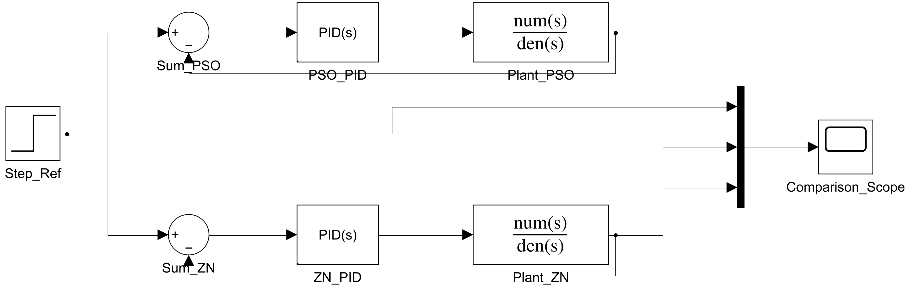
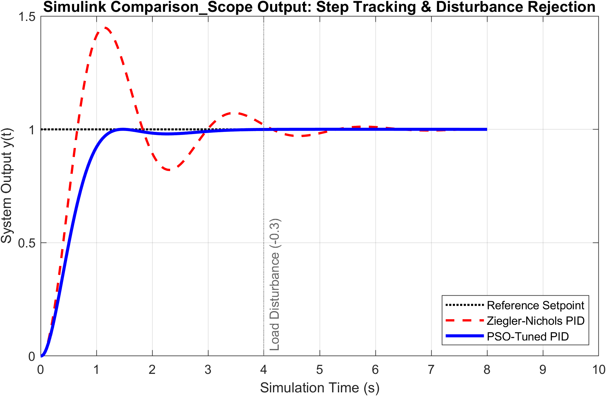
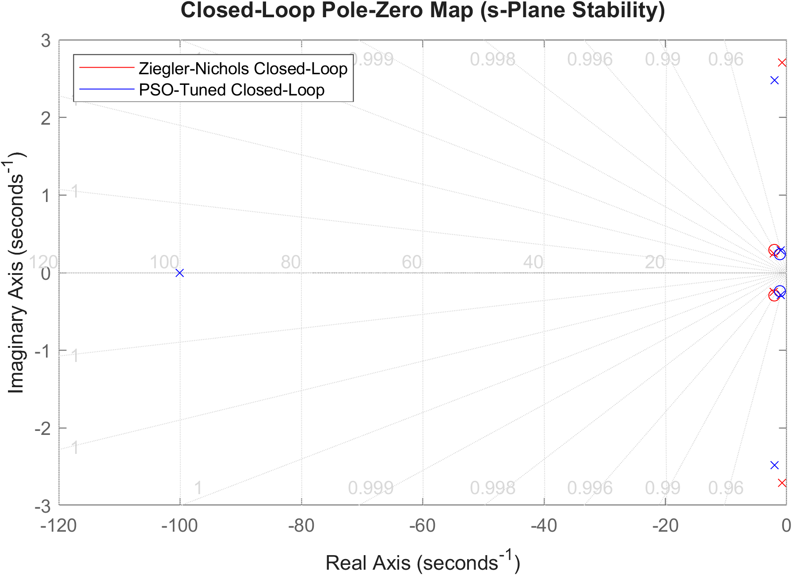
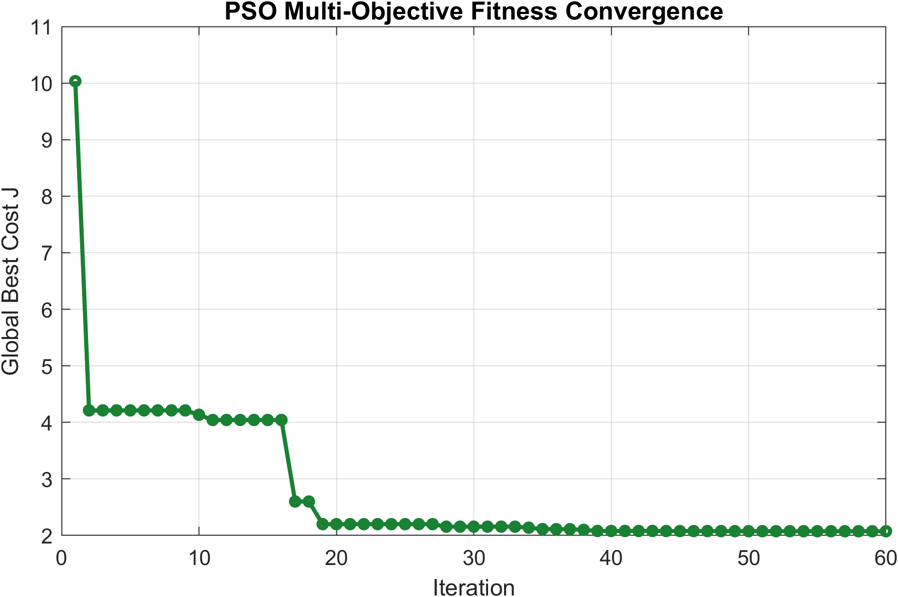

# PSO-Tuned PID Control Optimization in MATLAB/Simulink

[](https://matlab.mathworks.com/open/github/v1?repo=Rajubahardar/PSO-Tuned-PID-Control-Optimization)
[](#system-architecture--plant-model)
[](#controller-formulation--pso-parameters)
[-B71C1C)](results/project_report.pdf)
[](LICENSE)

An automated, stability-constrained **Particle Swarm Optimization (PSO)** framework for synthesizing optimal Proportional–Integral–Derivative ($K_p, K_i, K_d$) controller gains in **MATLAB and Simulink**. Benchmarked against classical **Ziegler–Nichols** tuning on a third-order linear time-invariant (LTI) plant, the suite validates step-response transient performance, external load disturbance rejection ($t = 4\text{ s}$), closed-loop $s$-plane pole migration, and open-loop Gain/Phase stability margins.

> **Read Full Technical Report:** Open **[`results/project_report.pdf`](results/project_report.pdf)** for complete Routh–Hurwitz marginal stability proofs, Final Value Theorem disturbance-rejection derivations, textbook curriculum mapping, and full simulation benchmarks.

---

## Key Highlights

- **Near-Zero Overshoot (`99.9%` Reduction):** `PSO-Tuned PID` eliminates the severe oscillatory ringing of classical tuning—cutting maximum percentage overshoot from **44.94%** (Ziegler–Nichols) down to **0.04%**.
- **75.7% Faster Settling Time:** Closed-loop $2\%$ settling time drops from **4.94 s** to **1.20 s** while reducing steady-state tracking error to **0.0001**.
- **Superior Load Disturbance Rejection (`t = 4 s`):** Under a $-0.3$ step load disturbance injected at the plant input, `PSO-Tuned PID` cuts peak output deviation by **67.5%** (**0.0110** vs. **0.0338**) and recovers smoothly without secondary oscillations.
- **Expanded Frequency-Domain Stability Margins:** Phase margin increases from **28.98°** to **69.63°** (well inside the textbook $45^\circ\text{–}65^\circ+$ design target) and gain margin improves from **26.73 dB** to **33.69 dB**.

---

## System Architecture & Plant Model

| Component | Transfer Function / Formulation | Role in Benchmark |
| :--- | :--- | :--- |
| **Controlled Plant $G(s)$** | $G(s) = \dfrac{1}{(s+1)(s+2)(s+3)} = \dfrac{1}{s^3 + 6s^2 + 11s + 6}$ | Overdamped 3rd-order Type-0 LTI system ($K_u = 60$, $P_u = \frac{2\pi}{\sqrt{11}}\text{ s}$) |
| **Filtered PID $C(s)$** | $C(s) = K_p + \dfrac{K_i}{s} + \dfrac{K_d s}{T_f s + 1}, \quad T_f = 0.01\text{ s}$ | Realizable biproper PID controller ($N = 100$ derivative filter) |
| **Ziegler–Nichols Baseline** | $K_p = 0.6K_u,\; T_i = 0.5P_u,\; T_d = 0.125P_u$ | Classical ultimate-sensitivity reference controller |
| **PSO-Tuned PID** | $\min_{\mathbf{x} \in \Omega} J(\mathbf{x}) \;\text{ s.t. }\; \max_m \operatorname{Re}(\lambda_m) < 0$ | Swarm-synthesized optimal gains with Hurwitz stability barrier |

---

## Visual Results

### 1. Side-by-Side Simulink Block Diagram (`simulink/pid_pso_demo.slx`)

*Programmatically generated Simulink model comparing `PSO-Tuned PID` and `Ziegler-Nichols PID` under unit-step setpoint tracking ($t = 0\text{ s}$) and plant-input load disturbance injection ($A_d = -0.3$ at $t = 4\text{ s}$).*

### 2. Simulink `Comparison_Scope` Step Tracking & Disturbance Rejection

*Time-domain closed-loop response simulated with `ode45`. `PSO-Tuned PID` tracks the unit step with `0.04%` overshoot and rejects the $t = 4\text{ s}$ load disturbance with minimal transient dip.*

### 3. Closed-Loop $s$-Plane Pole-Zero Map

*Closed-loop pole migration showing `PSO-Tuned PID` shifting dominant poles deeper into the open left-half $s$-plane with higher damping ratio $\zeta$.*

### 4. Multi-Objective PSO Fitness Convergence

*Global best cost $J(\mathbf{g}_{\text{best}})$ convergence across 60 iterations ($N_p = 35$ particles).*

---

## Benchmark Results

### Time-Domain & Load Disturbance Metrics (`src/pso_pid_tuning.m`)

| Tuning Method | $K_p$ | $K_i$ | $K_d$ | Overshoot (%) | Settling Time (s) | Steady-State Error | Max Disturbance Drop |
| :--- | :---: | :---: | :---: | :---: | :---: | :---: | :---: |
| **Ziegler–Nichols PID** | `36.000` | `38.006` | `8.525` | `44.94%` | `4.94` | `0.0018` | `0.0338` |
| **PSO-Tuned PID** | **`18.002`** | **`10.627`** | **`7.880`** | **`0.04%`** | **`1.20`** | **`0.0001`** | **`0.0110`** |

### Open-Loop Frequency-Domain Stability Margins (`margin(C * G)`)

| Tuning Method | Gain Margin (dB) | Phase Margin (deg) | Phase Crossover $\omega_{cg}$ (rad/s) | Gain Crossover $\omega_{cp}$ (rad/s) |
| :--- | :---: | :---: | :---: | :---: |
| **Ziegler–Nichols PID** | `26.73` | `28.98` | `13.72` | `2.64` |
| **PSO-Tuned PID** | **`33.69`** | **`69.63`** | **`19.42`** | **`1.86`** |

---

## Controller Formulation & PSO Parameters

### Multi-Objective Cost Function with Hurwitz Stability Barrier

$$J(\mathbf{x}) = \begin{cases} 1.0\,\text{ITAE} + 0.6\,M_p + 1.5\,t_s + 25.0\,e_{ss}, & \text{if } \max_m \operatorname{Re}(\lambda_m) < 0 \\ 10^6, & \text{otherwise} \end{cases}$$

### Swarm Kinematic Update Equations

$$\mathbf{v}_i^{k+1} = w(k)\mathbf{v}_i^k + c_1 \mathbf{r}_1 \odot (\mathbf{p}_{\text{best},i} - \mathbf{x}_i^k) + c_2 \mathbf{r}_2 \odot (\mathbf{g}_{\text{best}} - \mathbf{x}_i^k), \qquad \mathbf{x}_i^{k+1} = \operatorname{clip}\!\left(\mathbf{x}_i^k + \mathbf{v}_i^{k+1},\; \mathbf{x}_{\min},\; \mathbf{x}_{\max}\right)$$

| Parameter | Symbol | Configured Value |
| :--- | :---: | :--- |
| Swarm Size & Iterations | $N_p,\; K_{\max}$ | `35` particles, `60` iterations (`rng(42, 'twister')`) |
| Linearly Annealed Inertia Weight | $w_{\max} \to w_{\min}$ | `0.9` $\to$ `0.4` |
| Cognitive & Social Acceleration | $c_1,\; c_2$ | `1.5`, `1.5` |
| Gain Search Bounds | $[K_p, K_i, K_d]$ | $[0, 45] \times [0, 45] \times [0, 25]$ |

---

## Repository Structure

```text
PSO-Tuned-PID-Control-Optimization/
├── src/
│   ├── evaluate_pid.m                  # Multi-objective fitness & Hurwitz stability gate
│   ├── pso_pid_tuning.m                # PSO optimizer, ZN baseline, margins & 300-DPI plots
│   └── build_simulink_model.m          # Programmatic Simulink block-diagram generator
├── simulink/
│   └── pid_pso_demo.slx                # Side-by-side closed-loop step & disturbance model
├── results/
│   ├── project_report.pdf              # Full technical report with proofs & benchmarks
│   ├── tuned_gains.mat                 # Saved optimal Kp, Ki, Kd workspace variables
│   ├── simulink_model.png              # 300-DPI Simulink block diagram
│   ├── simulink_scope_output.png       # 300-DPI Simulink Comparison_Scope waveform
│   ├── pole_zero_map.png               # 300-DPI closed-loop s-plane pole-zero plot
│   └── convergence_curve.png           # 300-DPI PSO fitness convergence curve
├── docs/
│   ├── project_report.tex              # LaTeX source for project_report.pdf
│   ├── theoretical_proofs.md           # Routh-Hurwitz & Final Value Theorem derivations
│   ├── textbook_comparison.md          # Curriculum alignment & viva defense guide
│   └── slide_outline.md                # Competition presentation deck outline
├── .gitignore                          # Excludes MATLAB/Simulink & LaTeX build caches
└── README.md                           # Project overview, benchmark tables & quick start
```

---

## Reproducibility & Quick Start

1. **Clone the repository (Terminal / PowerShell):**
   ```bash
   git clone [https://github.com/Rajubahardar/PSO-Tuned-PID-Control-Optimization.git](https://github.com/Rajubahardar/PSO-Tuned-PID-Control-Optimization.git)
   ```

2. **Run the PSO optimizer and launch the Simulink demo (MATLAB Command Window):**
   ```matlab
   cd('PSO-Tuned-PID-Control-Optimization');
   run('src/pso_pid_tuning.m');
   run('src/build_simulink_model.m');
   ```

---

## Citation

```bibtex
@misc{bahardar2025psopid,
  author       = {Bahardar, Raju},
  title        = {PSO-Tuned PID Control Optimization in MATLAB/Simulink},
  year         = {2025},
  howpublished = {\url{[https://github.com/Rajubahardar/PSO-Tuned-PID-Control-Optimization](https://github.com/Rajubahardar/PSO-Tuned-PID-Control-Optimization)}},
  note         = {MATLAB/Simulink Control Systems & Swarm Intelligence Project}
}
```

---

## License

This project is released under the [MIT License](LICENSE).